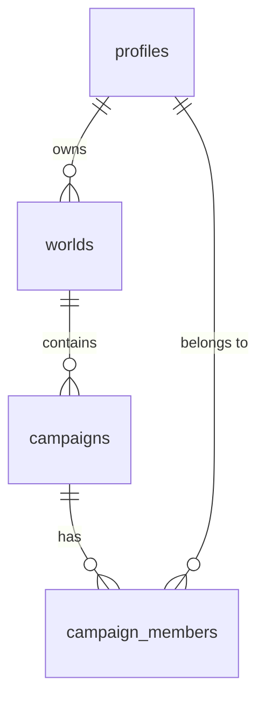

# Data model: worlds, campaigns and memberships

The SQL lives in [`supabase/migrations/`](../supabase/migrations). Nothing is connected to Supabase yet.



| Table              | What it holds                                                                              |
| ------------------ | ------------------------------------------------------------------------------------------ |
| `profiles`         | One row per login account: `username`, `display_name`. Created automatically with the account. |
| `worlds`           | A setting (e.g. a homebrew world). Has one `owner_id`.                                     |
| `campaigns`        | A campaign inside a world.                                                                 |
| `campaign_members` | Who is in each campaign, with role `dm` or `player`. One person can join many campaigns.  |

## Roles

| Role       | Where it comes from                    | Can (once access rules are added)                                  |
| ---------- | -------------------------------------- | ------------------------------------------------------------------ |
| **Owner**  | `worlds.owner_id`                      | Everything in the world: shared lore and all its campaigns.        |
| **DM**     | `campaign_members.role = 'dm'`         | Manage their campaign, including adding and removing members.      |
| **Player** | `campaign_members.role = 'player'`     | See their campaign's player-visible content and shared world lore. |

Members of any campaign in a world can see that world's shared lore, so no separate "world members" table is needed.

## Future content (Codex, NPCs, locations, quests, sessions)

Each future content table follows the same pattern, so world sharing and campaign privacy work the same way everywhere:

```sql
create table public.npcs (
  id          uuid primary key default gen_random_uuid(),
  world_id    uuid not null references public.worlds (id) on delete cascade,
  campaign_id uuid,                                  -- null = shared world lore
  visibility  text not null default 'players'        -- 'players' or 'dm'
              check (visibility in ('players', 'dm')),
  name        text not null,
  -- ...feature-specific columns...
  foreign key (campaign_id, world_id) references public.campaigns (id, world_id) on delete cascade
);
```

- `campaign_id` empty: shared with every campaign in the world.
- `campaign_id` set: private to that campaign; other campaigns never see it.
- `visibility = 'dm'`: hidden from players, even within the right campaign.
- The two-column foreign key stops a campaign's content being attached to the wrong world.

Session timelines would simply be campaign-specific (`campaign_id` required).

## Linking the first DM account (B006 onwards)

1. Run the migrations on the new Supabase project.
2. Create the DM's login account in the Supabase dashboard. The `profiles` row is created automatically.
3. Edit the placeholders in [`supabase/setup-first-dm.sql`](../supabase/setup-first-dm.sql) and run it once in the SQL editor. It creates the world and campaign, and makes the DM both world Owner and campaign DM.

Real world and campaign names are only entered in Supabase, never committed to this public repository.

## Access rules

Row level security is switched on for every table but no rules exist yet, so the public API can read nothing. The access rules above will be written as Supabase policies in a later task.
