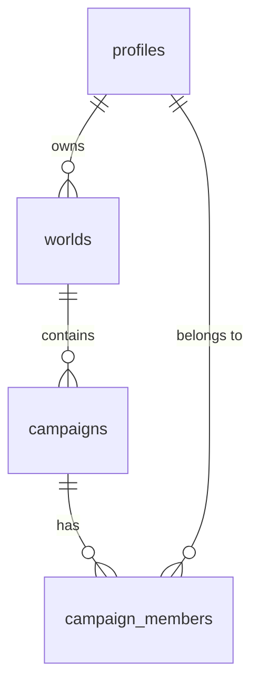
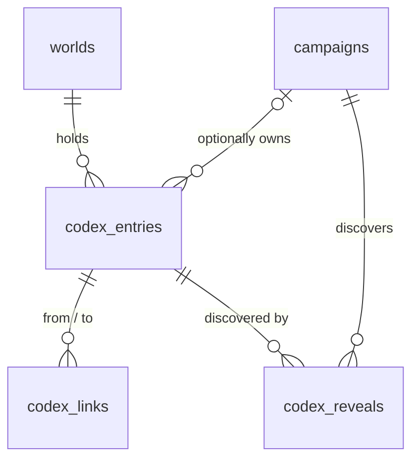

# Data model: worlds, campaigns and memberships

The SQL lives in [`supabase/migrations/`](../supabase/migrations). Nothing is connected to Supabase yet.

| Table              | What it holds                                                                              |
| ------------------ | ------------------------------------------------------------------------------------------ |
| `profiles`         | One row per real person (player or DM): `username`, `display_name`. Created automatically with their account. |
| `worlds`           | A setting (e.g. a homebrew world). Has one `owner_id`.                                     |
| `campaigns`        | A campaign inside a world.                                                                 |
| `campaign_members` | Who is in each campaign, with role `dm` or `player`. One person can join many campaigns.  |

## Roles

| Role       | Where it comes from                    | Can (once access rules are added)                                  |
| ---------- | -------------------------------------- | ------------------------------------------------------------------ |
| **Owner**  | `worlds.owner_id`                      | Everything in the world: shared lore and all its campaigns.        |
| **DM**     | `campaign_members.role = 'dm'`         | Manage their campaign, including adding and removing members.      |
| **Player** | `campaign_members.role = 'player'`     | See their campaign's player-visible content and shared world lore. |

Members of any campaign in a world can see that world's *published* shared lore, so no separate "world members" table is needed.

## Accounts

- **One account per real person.** A player keeps the same username and password across all their campaigns and characters.
- **Characters** (a later task) will be separate records linked to the player's profile, so one player can have many characters.
- **Passwords** are created by the DM, reasonably secure, and given to each player privately.
- **Usernames:** players log in with a friendly username and never need to give an email address. How that maps onto Supabase's login system is decided in B007. Don't assume made-up email addresses on real-looking domains.

## Codex (B011)

Defined in [`20261028000003_codex.sql`](../supabase/migrations/20261028000003_codex.sql) and checked by `node scripts/codex-test.mjs`.

| Table           | What it holds                                                                                                         |
| --------------- | --------------------------------------------------------------------------------------------------------------------- |
| `codex_entries` | One entry: `category` (`npc`, `location`, `faction`, `item`, `lore`), `name`, `summary`, `description`, `tags`, `visibility`. `campaign_id` empty = world lore. |
| `codex_links`   | A named relationship between two entries in the same world (`relation`, e.g. "lives in", "member of"), with its own `visibility`. |
| `codex_reveals` | A DM-only entry that one campaign's party has discovered.                                                             |

| Visibility             | World entry (no campaign)                                   | Campaign entry                         |
| ---------------------- | ----------------------------------------------------------- | -------------------------------------- |
| `draft` (default)      | World Owner only                                            | That campaign's DM (and the Owner)     |
| `dm` (secret)          | Owner and every DM in the world; players only once revealed to their campaign | That campaign's DM; its players only once revealed |
| `players` (published)  | Players in every campaign of the world                      | That campaign's players only           |

- **Editing:** the Owner edits world entries and links; a campaign's DM edits that campaign's entries and links and records its discoveries. Players can't change the Codex. Entries can't be moved between worlds or campaigns.
- **Links** only show when the link and *both* entries are visible, so a secret relationship or a hidden entry never leaks through a link.
- **Stable IDs:** every entry keeps its `id` forever. Future map markers and timeline events should reference `codex_entries (id, world_id)`. This two-column reference guarantees they stay in the same world, as `codex_links` and `codex_reveals` already do.
- **Extending:** new categories can be added with `alter type public.codex_category add value '...'`. New feature tables follow the same `world_id` / `campaign_id` / `visibility` pattern and must add their own grants and policies.

## Linking the first DM account (B006 onwards)

1. Run the migrations on the new Supabase project.
2. Create the DM's login account in the Supabase dashboard. The `profiles` row is created automatically.
3. Edit the placeholders in [`supabase/setup-first-dm.sql`](../supabase/setup-first-dm.sql) and run it once in the SQL editor. It creates the world and campaign, and makes the DM both world Owner and campaign DM.

Real world and campaign names are only entered in Supabase, never committed to this public repository.

## Access rules (B008)

Defined in [`20261028000001_access_policies.sql`](../supabase/migrations/20261028000001_access_policies.sql) and checked by `node scripts/access-test.mjs`.

| Who                 | Can see                                                        | Can change                                                              |
| ------------------- | -------------------------------------------------------------- | ----------------------------------------------------------------------- |
| Signed out          | Nothing                                                        | Nothing                                                                 |
| Any signed-in user  | Their own profile                                              | Their own display name                                                  |
| Player              | Their campaigns, those campaigns' world, fellow members and their profiles | Nothing else                                                 |
| Campaign DM         | As a player                                                    | Rename the campaign; add, remove and change roles of its members        |
| World Owner         | Their world, all its campaigns, members and their profiles     | Rename the world; create campaigns; everything a DM can do in its campaigns |

- Nobody can delete worlds or campaigns, change a world's owner, move a campaign to another world or change a username from the website. The DM's local scripts (secret key) can.
- Membership checks are small `security definer` functions in a `private` schema, which the API doesn't expose. This avoids recursive policies.
- Signed-out visitors have no table privileges at all. **New tables get no access by default**, so each new feature's migration must `grant` exactly what it needs and add its own policies, following the visibility pattern above.
