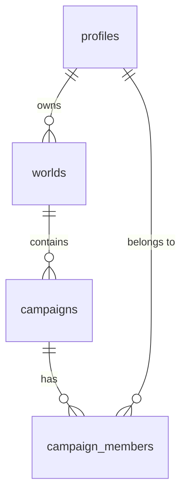

# Data model: worlds, campaigns and memberships

The SQL lives in [`supabase/migrations/`](../supabase/migrations). Nothing is connected to Supabase yet.



| Table              | What it holds                                                                              |
| ------------------ | ------------------------------------------------------------------------------------------ |
| `profiles`         | One row per real person (player or DM): `username`, `display_name`. Created automatically with their account. |
| `worlds`           | A setting (e.g. a homebrew world). Has one `owner_id`.                                     |
| `campaigns`        | A campaign inside a world.                                                                 |
| `campaign_members` | Who is in each campaign, with role `dm` or `player`. One person can join many campaigns.  |

## Roles

| Role       | Where it comes from                    | Can (once access rules are added)                                  |
| ---------- | -------------------------------------- | ------------------------------------------------------------------ |
| **Owner**  | `worlds.owner_id`                      | Everything in the world: shared lore and all its campaigns.        |
| **DM**     | `campaign_members.role = 'dm'`         | Manage their campaign, including adding and removing members.      |
| **Player** | `campaign_members.role = 'player'`     | See their campaign's player-visible content and shared world lore. |

Members of any campaign in a world can see that world's *published* shared lore, so no separate "world members" table is needed.

## Accounts

- **One account per real person.** A player keeps the same username and password across all their campaigns and characters.
- **Characters** (a later task) will be separate records linked to the player's profile, so one player can have many characters.
- **Passwords** are created by the DM, reasonably secure, and given to each player privately.
- **Usernames:** players log in with a friendly username and never need to give an email address. How that maps onto Supabase's login system is decided in B007. Don't assume made-up email addresses on real-looking domains.

## Future content (Codex, NPCs, locations, quests, sessions)

Each future content table follows the same pattern, so world sharing and campaign privacy work the same way everywhere. Example for the Codex:

```sql
create table public.codex_entries (
  id          uuid primary key default gen_random_uuid(),
  world_id    uuid not null references public.worlds (id) on delete cascade,
  campaign_id uuid,                                  -- null = world lore, reusable by every campaign
  visibility  text not null default 'draft'
              check (visibility in ('draft', 'dm', 'players')),
  title       text not null,
  -- ...feature-specific columns...
  foreign key (campaign_id, world_id) references public.campaigns (id, world_id) on delete cascade
);

-- A world secret revealed to one campaign only (e.g. what that party discovered)
create table public.codex_entry_reveals (
  entry_id    uuid not null references public.codex_entries (id) on delete cascade,
  campaign_id uuid not null references public.campaigns (id) on delete cascade,
  primary key (entry_id, campaign_id)
);
```

| Entry                                           | Who can see it                                                    |
| ----------------------------------------------- | ----------------------------------------------------------------- |
| `draft` (unpublished)                           | Only the world Owner (or, for campaign entries, that campaign's DM). |
| `dm` (DM secret)                                | The Owner and DMs. Players never see it…                          |
| …plus a row in `codex_entry_reveals`            | …except players of that one campaign, once they've discovered it. |
| `players`, no `campaign_id`                     | Players in every campaign of the world (common knowledge).        |
| `players`, with `campaign_id`                   | Only that campaign's players (campaign-specific discoveries and notes). |

- One world entry is written once and reused by every campaign. Each campaign only sees what is published, or what it has discovered.
- The two-column foreign key stops a campaign's content being attached to the wrong world.
- NPCs, locations and quests can copy the same columns, and add their own reveals table only if needed.
- Session timelines are simply campaign-specific (`campaign_id` required).

## Linking the first DM account (B006 onwards)

1. Run the migrations on the new Supabase project.
2. Create the DM's login account in the Supabase dashboard. The `profiles` row is created automatically.
3. Edit the placeholders in [`supabase/setup-first-dm.sql`](../supabase/setup-first-dm.sql) and run it once in the SQL editor. It creates the world and campaign, and makes the DM both world Owner and campaign DM.

Real world and campaign names are only entered in Supabase, never committed to this public repository.

## Access rules (B008)

Defined in [`20261028000001_access_policies.sql`](../supabase/migrations/20261028000001_access_policies.sql) and checked by `node scripts/access-test.mjs`.

| Who                 | Can see                                                        | Can change                                                              |
| ------------------- | -------------------------------------------------------------- | ----------------------------------------------------------------------- |
| Signed out          | Nothing                                                        | Nothing                                                                 |
| Any signed-in user  | Their own profile                                              | Their own display name                                                  |
| Player              | Their campaigns, those campaigns' world, fellow members and their profiles | Nothing else                                                 |
| Campaign DM         | As a player                                                    | Rename the campaign; add, remove and change roles of its members        |
| World Owner         | Their world, all its campaigns, members and their profiles     | Rename the world; create campaigns; everything a DM can do in its campaigns |

- Nobody can delete worlds or campaigns, change a world's owner, move a campaign to another world or change a username from the website. The DM's local scripts (secret key) can.
- Membership checks are small `security definer` functions in a `private` schema, which the API doesn't expose. This avoids recursive policies.
- Signed-out visitors have no table privileges at all. **New tables get no access by default**, so each new feature's migration must `grant` exactly what it needs and add its own policies, following the visibility pattern above.
